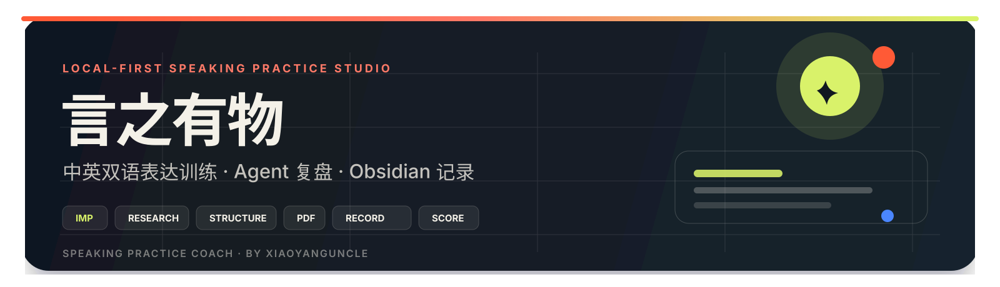
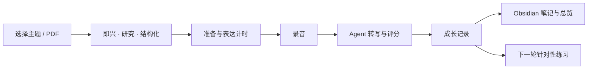

<p align="center">
  
</p>

<p align="center">
  <a href="https://www.npmjs.com/package/react"></a>
  <a href="https://vite.dev/"></a>
  <a href="https://nodejs.org/"></a>
  <a href="https://github.com/XiaoYangUncle"></a>
  <a href="https://obsidian.md/"></a>
</p>

<p align="center">
  <strong>把每一次开口，变成一条看得见、可复盘、能同步到 Obsidian 的成长记录。</strong>
</p>

<p align="center">
  <a href="INSTALL.md"><b>安装说明</b></a>
  ·
  <a href="#快速开始"><b>快速开始</b></a>
  ·
  <a href="#功能">功能</a>
  ·
  <a href="#obsidian-输出示例">Obsidian</a>
  ·
  <a href="https://github.com/XiaoYangUncle/xiaoyang-speaking-coach"><b>GitHub</b></a>
</p>

---

> **言之有物** 是一个本地优先的中英双语表达训练工作台。它把随机题库、计时练习、录音、Agent 转写评分、成长记录和 Obsidian 同步放进同一条训练闭环里。项目同时打包为 Agent Skill：`xiaoyang-speaking-coach`。

## 快速开始

### 方式一：通过 Agent Skill 安装

适合已经使用 **Codex** 或 **Claude Code** 的朋友。

```bash
git clone https://github.com/XiaoYangUncle/xiaoyang-speaking-coach.git
```

将 `skills/xiaoyang-speaking-coach` 复制到对应 Skill 目录：

```text
Codex:       ~/.codex/skills/xiaoyang-speaking-coach
Claude Code: ~/.claude/skills/xiaoyang-speaking-coach
```

重启 Agent，然后说：

```text
使用 $xiaoyang-speaking-coach 在本地启动言之有物
```

### 方式二：直接启动

```bash
git clone https://github.com/XiaoYangUncle/xiaoyang-speaking-coach.git
cd xiaoyang-speaking-coach/skills/xiaoyang-speaking-coach
node scripts/start-local.mjs
```

首次运行会自动安装依赖、构建项目并启动：

```text
http://127.0.0.1:5173/
```

> 完整 macOS / Windows 步骤、端口配置、麦克风权限和常见问题见 **[INSTALL.md](INSTALL.md)**。

> **Agent 是可选能力。** 基础题库、计时、录音、成长记录和 Obsidian 同步不需要 Codex/WorkBuddy。自动拆题和录音评分需要本机找到并登录其中一个 CLI；只打开桌面端不等于已经配置好。启动脚本会打印 `Agent capability check` 并给出配置提示。

### 方式三：作为 Codex Git 插件市场安装

```bash
codex plugin marketplace add XiaoYangUncle/xiaoyang-speaking-coach
codex plugin add xiaoyang-speaking-coach@xiaoyang-speaking-coach
```

> 这是 Git 托管的自定义插件市场，不依赖 OpenAI 官方精选市场。

## 为什么不一样

| 能力 | 说明 |
|---|---|
| **本地优先** | 网页、录音和历史记录运行在本机浏览器中，默认只监听 `127.0.0.1` |
| **训练完整链路** | 不只是抽题和计时，而是覆盖准备、表达、录音、转写、评分和复盘 |
| **过程可追溯** | 记录准备时长、实际表达、暂停、录音设备、阶段到达点和结束方式 |
| **Agent 可用** | 支持 Codex CLI / WorkBuddy，把大主题或 PDF 拆成可练习的小主题 |
| **不强行打分** | 没有转写时，内容相关维度保持不可评，不编造分数 |
| **Obsidian 友好** | 每次训练生成一篇笔记，并维护一个可检索的训练总览 |

## 功能

<table>
  <tr>
    <td width="50%">
      <h3>🎯 中英双语题库</h3>
      <p>即兴表达、研究陈述、结构化回答使用独立主题池。覆盖日常、深度概念、科技、商业、历史、文学、考研、考公、求职与工作汇报等场景。</p>
    </td>
    <td width="50%">
      <h3>🧩 智能拆题</h3>
      <p>输入一个大主题或上传 PDF，通过本机 Agent 自动拆解为更小、更可执行的表达题目，并保存到自定义主题组。</p>
    </td>
  </tr>
  <tr>
    <td width="50%">
      <h3>⏱️ 三阶段训练</h3>
      <p>开始前 3 秒倒计时。调研准备、结构化准备、正式表达分别计时，支持暂停、重来、阶段提示和手动结束。</p>
    </td>
    <td width="50%">
      <h3>🎙️ 录音与回放</h3>
      <p>表达阶段自动录音，优先选择真实麦克风；启动失败可重试，结束后由用户选择保存或丢弃本轮记录。</p>
    </td>
  </tr>
  <tr>
    <td width="50%">
      <h3>🧠 Agent 评分</h3>
      <p>按内容、结构、简洁度、论证和表达五个维度分析，给出具体优点、修改建议和下一步练习动作。</p>
    </td>
    <td width="50%">
      <h3>📈 成长记录</h3>
      <p>支持搜索、筛选、评分/时长排序、近 7 天趋势和分批加载。训练越多，越容易发现自己的表达模式。</p>
    </td>
  </tr>
  <tr>
    <td width="50%">
      <h3>🗂️ 自定义主题库</h3>
      <p>可新建主题组、收藏题目、移动题目，把拆解结果归入自己的主题体系。</p>
    </td>
    <td width="50%">
      <h3>🔒 本地数据</h3>
      <p>历史、偏好和录音保存在浏览器本地；只有主动触发 Agent 分析时，相关音频才会进入本机 Agent 链路。</p>
    </td>
  </tr>
</table>

## 训练闭环



## 评分规则

| 维度 | 权重 | 观察重点 |
|---|---:|---|
| 内容 | 30% | 主题相关性、信息量、观点完整度 |
| 结构 | 20% | 开场、层次、推进和收束 |
| 简洁度 | 15% | 重复、口头填充和冗余 |
| 论证 | 20% | 例子、数据、因果和可信度 |
| 表达 | 15% | 语速、停顿、流畅度和语气 |

没有可靠转写时，系统不会伪造内容分数。

## Obsidian 输出示例

每轮训练会生成独立笔记，并自动更新 `言之有物 · 训练总览.md`。

```markdown
# 用一分钟解释复利

## 训练信息
- 模式：研究陈述
- 实际表达：52.4 秒
- 综合评分：78

## 训练过程
- 准备用时：3 分 00 秒
- 暂停次数：2
- 录音设备：MacBook Pro Microphone

### 过程时间线
| 相对时间 | 事件 |
|---|---|
| +0 秒 | 开始查阅与梳理 |
| +30 秒 | 准备完成 |
| +1 分 00 秒 | 开始表达 |
| +1 分 15 秒 | 到达阶段 1/3 |

## 最终结果
维度评分、优点、优化建议和下一步动作会写入同一篇笔记。
```

## 技术栈

<p>
  
  
  
  
  
</p>

## 目录

```text
xiaoyang-speaking-coach/
├── INSTALL.md                         # 朋友可读的安装说明
├── skills/
│   └── xiaoyang-speaking-coach/       # 自包含 Agent Skill
│       ├── SKILL.md
│       ├── agents/openai.yaml
│       ├── references/deployment.md
│       ├── scripts/start-local.mjs
│       └── assets/app/                # 打包后的应用源码
├── src/
│   ├── components/                    # 页面与训练组件
│   ├── data/                          # 双语主题库
│   └── lib/                           # 音频、存储、分析等工具
├── scripts/package-skill.mjs          # 重新生成 Skill 内置应用
└── vite.config.ts                     # 本地 Agent 与 Obsidian 桥接
```

## 开发与打包

```bash
npm install
npm run dev
```

生产构建：

```bash
npm run build
npm run preview
```

修改应用后重新生成 Skill 内置版本：

```bash
npm run package:skill
```

<details>
<summary><b>Agent 环境变量</b></summary>

| 变量 | 用途 |
|---|---|
| `CODEX_CLI_PATH` | 自定义 Codex CLI 路径 |
| `WORKBUDDY_CLI_PATH` | 自定义 WorkBuddy CodeBuddy CLI 路径 |
| `WORKBUDDY_GATEWAY_URL` | WorkBuddy 本地远程 Agent 网关 |
| `WORKBUDDY_GATEWAY_PASSWORD` | WorkBuddy 网关密码 |
| `SAYFIELD_WORKBUDDY_WORKSPACE` | WorkBuddy 可访问的临时录音目录 |
| `SAYFIELD_WHISPER_MODEL` | 本地 Whisper 备用转写模型 |
| `SAYFIELD_WHISPER_CACHE` | Whisper 模型缓存目录 |

</details>

<details>
<summary><b>隐私与数据位置</b></summary>

- 训练历史与偏好：浏览器本地存储
- 录音：浏览器 IndexedDB
- Obsidian 笔记：用户选择的本地 Vault
- Agent 请求：仅通过本机 `127.0.0.1` 桥接
- 清除浏览器站点数据会同时清除训练历史和录音

</details>

---

<p align="center">
  <strong>言之有物 · Speaking Practice Coach</strong><br />
  Built by <a href="https://github.com/XiaoYangUncle">@XiaoYangUncle / 小杨叔叔</a>
</p>

<p align="center">
  如果这个项目对你有帮助，欢迎 Star ⭐
</p>
